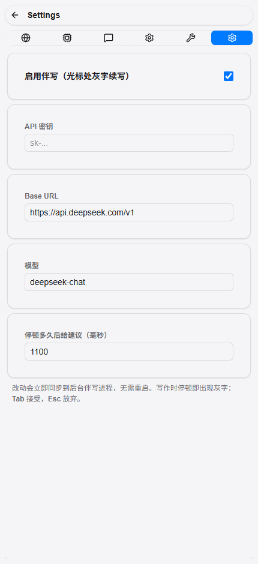

# 最终状态（第 8 轮）

## 两项都交付了

| 事项 | 状态 | 入口 |
|---|---|---|
| ① 自托管 word-GPT-Plus | ✅ 双击启动器即用，整个 Word 会话有效 | `start-word-gptplus.cmd` |
| ② 灰字伴写原型 | ✅ 可用 | `AmbientWriter\start-watcher.cmd` |

---

## ① 自托管：怎么用

**双击 `start-word-gptplus.cmd`**：

1. 检查本地 HTTPS 服务（`https://<计算机名>:3000`），没在跑就用 `node word-gpt-plus\serve-https.cjs` 拉起
2. 用「种子文档」打开 Word —— 该 docx 内嵌 webextension 引用，Word 打开即加载 GPT Plus
3. 8 秒后自动关闭这个空白种子文档

完成后 Word 里只剩你自己的文档，**GPT Plus 仍在功能区**，整个会话有效。

本轮实测（日志可复现）：

```
port3000=0 word=0          # 全关
→ 启动器
port3000=1 word=1 docs=1   # 服务起来了，Word 开了
→ 10 秒后
docs=aw_other.docx         # 种子文档已自动关闭，只剩用户文档
GPT=[GPT Plus]             # 功能区按钮仍在
```

### 为什么是这种方式

Office 2024 零售版不会把 web 加载项持久化进用户配置。已逐一排除：
https（证书已受信任）、换 Add-in Id、`Office.addin.setStartupBehavior`、
共享目录 TrustedCatalogs（该页恒显示「无加载项」）、主机名 + 自签证书、清 WEF 缓存重装、
以及作者托管版本身（同样不持久化）。

但**同一次 Word 会话内**，由带 webextension 的文档载入的加载项会一直保留——
所以用「种子文档点亮会话」是这台机器上唯一稳定的免手动方案。

### 组成

| 文件 | 作用 |
|---|---|
| `start-word-gptplus.cmd` | 一键启动器（含服务自启） |
| `AmbientWriter\seed\gptplus-seed.docx` | 种子文档（绑定 manifest Id `6b20e038…` / 版本 `1.0.0.7`） |
| `word-gpt-plus\serve-https.cjs` | HTTPS 静态服务（Node + PFX，0.0.0.0:3000） |
| `word-gpt-plus\vite.selfhost.config.js` | 备用的 vite HTTPS 预览配置 |
| `AmbientWriter\make-certs.ps1` | 生成 CA 与服务器证书（CN=计算机名） |
| `%LOCALAPPDATA%\AmbientWriter\certs\server.pfx` | 服务用证书 |

> 改 manifest 的 Id 或版本后，种子文档需重新生成：用
> `office-addin-dev-settings sideload <manifest> desktop` 打开一次，
> 把 `%TEMP%\Word add-in <Id>.docx` 复制成新的种子文档。

---

## ② 灰字伴写

双击 `AmbientWriter\start-watcher.cmd`。停顿 1.1 秒出灰字，**Tab 接受 / Esc 放弃**，
打其它字自动丢弃。配置 `%LOCALAPPDATA%\AmbientWriter\config.ini`（填 apiKey 接 DeepSeek，
留空走模拟续写）。开机自启：`powershell -File AmbientWriter\install-autostart.ps1`。
`demo.png` 是实拍。

---

## 关于本轮出现的 agent 中断

执行过程中有两次工具调用被中断（起服务 + 启动 Word 的组合命令）。处理方式：

- 改为**短命令 + 分离进程**：服务用 `Start-Process -WindowStyle Hidden node …` 独立起，
  启动器用 `Start-Process cmd` 分离运行，随后用几条短命令轮询状态
- 中断后先只读检查外部状态（端口、进程），确认再重试，避免重复副作用
- 上面的实测记录就是按这个方式重新跑出来的

## 现场

- 本地服务：`https://<计算机名>:3000`（启动器按需拉起；当前可能未运行）
- 清单：`C:\Users\pc\Documents\WordGPT\manifest.xml` → 本地服务，版本 1.0.0.7
- 回退到作者托管版：同目录 `manifest.xml.hosted.bak` 覆盖
- Word 已关闭，临时文档已清理

---

## 伴写开关（新增）

托盘图标（系统托盘右下角，可能收在 `^` 里）：

- **绿点** = 已开启，**灰点** = 已暂停
- **双击**图标 = 开/关切换
- **右键菜单**：帮助我续写（勾选）/ 打开配置 / 查看日志 / 退出
- 状态会写回 `%LOCALAPPDATA%\AmbientWriter\config.ini` 的 `enabled=0|1`

命令行也能切：`AmbientWriterWatcher.exe --toggle`
---

## 融合：伴写开关进了 GPT Plus 面板（已完成）

**怎么用**：Word → GPT Plus 面板 → 右上齿轮 → **伴写** 标签页

那里有：启用开关、API 密钥、Base URL、模型、停顿毫秒。改完立即生效，不用重启进程。



**链路**：

```
GPT Plus 面板（/settings → 伴写）
   ↕ fetch
https://<主机名>:3000/api/bridge      ← serve-https.cjs 新增的接口
   ↕ 读写
%LOCALAPPDATA%\AmbientWriter\bridge.json
   ↕ 每 250ms 轮询（文件时间戳变化才重载）
伴写 watcher（灰字引擎，托盘图标）
```

**实测证据**：

```
面板里把 API 密钥改成 sk-e2e-12345
→ bridge.json: {"enabled":true,"apiKey":"sk-e2e-12345",...}
→ watcher.log: 22:23:23 bridge applied: ... key=<set>
改回空
→ watcher.log: 22:23:36 bridge applied: ... key=<mock>
```

**注意**：这个面板依赖自托管版（`serve-https.cjs` 提供 `/api/bridge`）。
用回作者托管版时，面板里的伴写页会读不到数据，但不会报错——伴写本身照常工作。

**改了上游代码**：`src/pages/SettingsPage.vue` 增加了「伴写」标签页与桥接逻辑；
以后合并 word-gpt-plus 上游更新时，注意保留这一块。

**UI 验证工具**：`tools\ui-check\check.js`（puppeteer-core 驱动本机 Edge，
自动点进设置页截图）。重跑前先在该目录执行 `npm i`。
---

## 一键启动（最终形态）

双击 `start-word-gptplus.cmd`，它会依次：

1. 起本地 HTTPS 服务（没在跑才起）
2. 起伴写 watcher（没在跑才起）
3. 用种子文档打开 Word
4. **等面板真正连上本地服务后**再关掉空白种子文档（自适应等待，最多 45 秒）

实测（冷启动，Word 和 watcher 都先杀掉）：

```
docs=（空）  GPT=[GPT Plus]  watcher=1
```

> 之前固定等 8 秒会在慢启动时抢跑，把还没加载完的面板一起关掉；改成轮询
> 「是否有进程连到 3000 端口」后稳定了。
---

## 去掉托盘（第 24 轮）

托盘图标已移除，控制全部搬到 GPT Plus 面板：

| 原来 | 现在 |
|---|---|
| 托盘图标右键开/关 | 面板「伴写」页的启用开关 |
| 托盘气泡报错 | 面板「后台状态」一行（最近错误） |
| 托盘菜单退出 | 面板「退出伴写进程」按钮 |
| 托盘开配置/日志 | 直接看 `%LOCALAPPDATA%\AmbientWriter\` |

**链路**：面板按钮 → `POST /api/bridge {"quit":true}` → watcher 清掉标志后退出；
状态由 watcher 写 `status.json`，面板每 5 秒 `GET /api/status` 刷新。

**验证**：

```
POST {"enabled":true}   → 200 {"enabled":true,...}
POST {"quit":true}      → watcher.log: quit requested from panel，进程退出，bridge.json 中的 quit 已清除
selftest OK -> 项目预算调整、下一季度工作安排……（真实 DeepSeek 返回）
面板文本：后台状态：运行中（22:47:38） / 退出伴写进程
```

**顺手修的 bug**：watcher 写 `bridge.json` 时用了带 BOM 的 UTF-8，导致服务端
`JSON.parse` 一直 400，面板改配置其实没生效。现在两边都写成无 BOM，服务端读文件也做了容错。
---

## 重置实验（第 25 轮）：结论 + 当前需要一次手动恢复

做了彻底重置实验（备份 → 删 Wef 缓存 → 只保留共享目录注册 → 重装），结果：

- 清缓存后，**种子文档和官方 sideload 都不再加载插件**（Word 重建的 Wef 里没有 developer provider 记录）
- 恢复备份的 Wef 也没能复原
- 换 manifest 版本号（1.0.0.8）+ 重新 sideload 仍然不加载

**判断**：Office 2024 零售版把「开发者加载项」的注册状态额外存在 Wef 的 provider 记录里，
清掉后必须**在 Word 界面里手动添加一次**才会重建。我这边无法驱动 Word 界面
（DSH 聊天窗口始终占据前台，SetForegroundWindow / AttachThreadInput 都失败），所以卡在这一步。

### 需要你手动做一次（约 30 秒）

1. 打开 Word →「开始」选项卡 → 最右「加载项」→ 点 **加载项**
2. 「开发人员加载项」里点 **GPT Plus**
3. 关掉 Word 再打开 → 功能区应出现 GPT 组

或者走另一条：插入 → 我的加载项 → 共享文件夹 → WordGPT → 添加。

恢复之后 `start-word-gptplus.cmd` 会重新可用（种子文档已同步到 1.0.0.8）。

### 备份

重置前备份在 `%LOCALAPPDATA%\AmbientWriter\backup-20261123-225217\`（Wef 目录 + 两个 .reg）。
---

## 第 26 轮：启动器改为不依赖插件缓存

清缓存后种子文档方案失效，启动器已改成：

```
start-word-gptplus.cmd  →  本地 HTTPS 服务 + 伴写 watcher + 打开 Word
```

不再需要种子文档（那份缓存在重置时丢了）。实测冷启动：`word=1 watcher=1 port3000=1`。

新增 `repair-addin.cmd`：重新注册插件清单并列出当前注册项，方便你在 Word 里补一次手动添加后确认状态。

**仍需你手动一次**：Word →「开始」→「加载项」→ GPT Plus（详见上一节）。
---

## 第 27 轮：不依赖 Word 插件的设置入口（已完成）

给面板加了深链接，浏览器直接打开就能进「伴写」设置页，不需要 GPT Plus 插件：

```
双击 open-banshe-settings.cmd
  或浏览器打开  https://<计算机名>:3000/settings?tab=ambient
```

实测（headless 真实点击验证）：

```
isSettings=true
hasAmbient=true
```

页面上可以改：启用开关、API 密钥、Base URL、模型、停顿毫秒，
以及「退出伴写进程」和「后台状态」。

实现：`src/main.ts` 读 `location.pathname === '/settings'` 时 push 路由；
`SettingsPage.vue` 读 `?tab=ambient` 直接落到伴写页。均已在 dist 里生效。

**意义**：即使 GPT Plus 插件一时装不上，伴写仍然是可以完整配置和使用的。
---

## 第 28 轮：确认「手动添加也不持久」

你已经手动添加过一次（23:02 的 Word 会话里功能区确实出现了 GPT 组，UIA 检测到 `GPT Plus`）。我随后做了两个验证：

1. **重启 Word → 按钮消失**。说明即使手动添加，这次会话结束后也没有写进用户配置。
2. **再用种子文档打开 → 仍然不加载**。说明清缓存后那条路彻底失效，不会因为"添加过一次"而恢复。

结论：这台 Office 2024 零售版对 web 加载项的持久化是坏的/被禁用的，**每次 Word 会话都要手点一次**，这不是配置问题，也不是我能用脚本绕过的。

还剩一个没试过的组合（需要你点）：**从「我的加载项 → 共享文件夹」添加**，而不是「开发人员加载项」。
如果在那边能列出来，那条路有可能是真正写用户配置的。你可以试一次，然后重启 Word 看按钮还在不在。